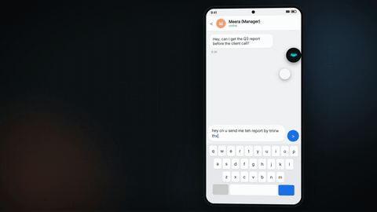
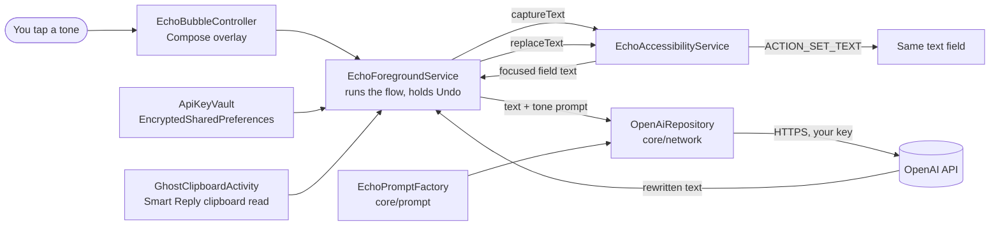

<p align="center">
  <a href="docs/media/echo-demo.mp4"></a>
  <br>
  <sub>Tap the preview to watch the full 54 second demo with sound.</sub>
</p>

# Echo

**Polished text inside any Android app. Type a messy draft, tap a bubble, and it is rewritten right where you typed it.**

Echo is a floating writing assistant for Android. It works in WhatsApp, Gmail, Slack, notes or any other app with a text box, without a custom keyboard. Under the hood an Accessibility Service reads the focused field when you tap, an LLM rewrites the text in the tone you pick, and Echo writes the result back into the same field. One tap undoes it.

## Features

- **Rewrite in place.** Reads the focused text field (or only the part you selected), rewrites it, and replaces it in the same field.
- **Five tones.** Professional, Friendly, Edgy, Promo and Fact Check, from a small menu on the bubble.
- **Fact Check that respects your style.** Fixes spelling, grammar and facts without changing your voice. If nothing needs fixing, Echo says so and leaves the field alone. When it does fix something, it shows a short reason.
- **Your own voice per tone.** Save a sample of how you write in a tone, and Echo uses it as a style example for that tone.
- **Smart Reply.** Copy a message you received, tap into your reply box, open Smart Reply on the bubble, and pick Accept, Decline or Clarify. Echo writes the reply straight into that box.
- **One tap Undo.** Restores what was in the field before the last rewrite or reply.
- **Pause.** A Pause button in the notification hides the bubble and stops all text capture until you resume.
- **Clear errors.** Missing key, invalid key, rate limits, no network, or an app that refuses text changes each show a plain message on the bubble.

## How it works

1. You tap a tone on the floating bubble.
2. `EchoAccessibilityService` finds the focused, editable, non password field and reads its text (or the current selection).
3. `OpenAiRepository` sends it to the OpenAI Chat Completions API (`gpt-4o-mini`) with a tone prompt built by `EchoPromptFactory`.
4. The rewritten text is written back into the same field with `ACTION_SET_TEXT`. The original is kept in memory so Undo can put it back.

## Architecture



| Component | Role |
|---|---|
| `EchoAccessibilityService` | Reads and replaces text in the focused field, only when asked. Ignores password fields. Does no work on accessibility events. |
| `EchoForegroundService` | Keeps the bubble alive and runs Polish, Smart Reply and Undo. |
| `EchoBubbleController` | The snap to edge bubble, tone menu, Smart Reply menu and status states, drawn with Compose in a `WindowManager` overlay. |
| `GhostClipboardActivity` | An invisible activity that takes focus for a moment, because Android 10+ only lets the focused app read the clipboard. This is what makes Smart Reply work. |
| `ApiKeyVault`, `SettingsVault` | Store the API key and your tone samples with `EncryptedSharedPreferences` (Android Keystore, AES-256). |

## Try it

1. Download [`android_apk_output/Echo-v3.0.3.apk`](android_apk_output/Echo-v3.0.3.apk) to an Android 10 or newer phone and install it (allow installs from your browser or file manager when asked).
2. Open Echo and paste your OpenAI API key.
3. Grant **Display over other apps**, then turn Echo on under **Settings > Accessibility > Echo**.
4. Open any app, type something messy in a text field, tap the Echo bubble and pick a tone.
5. Not happy with it? Tap the bubble again and hit Undo.

## Privacy

- There is no Echo server. Text goes from your phone straight to the OpenAI API with your own key, and only when you tap.
- Echo reads only the field in focus, only on a tap. It skips password fields, and Pause turns capture off completely.
- Your API key is encrypted on the device with the Android Keystore (AES-256).
- Debug logs record only text length, never the text itself.

## Build from source

Requirements: Android Studio (or the Android SDK with platform 35) and JDK 17.

```bash
git clone https://github.com/vigneshbs33/echo.git
cd echo
cp local.properties.example local.properties   # set sdk.dir to your Android SDK
./gradlew :apps:android:assembleDebug
```

The APK is written to `apps/android/build/outputs/apk/debug/`.

## Tech stack

- Kotlin, Jetpack Compose (Material 3)
- Android Accessibility Service and a `WindowManager` overlay
- Kotlin Coroutines
- Retrofit, OkHttp and Gson for the OpenAI API
- AndroidX Security Crypto (`EncryptedSharedPreferences`)
- Gradle Kotlin DSL with a version catalog, min SDK 29, target SDK 35

## Project structure

```
apps/android          App, accessibility service, foreground service, bubble overlay, vaults
feature/onboarding    Setup and settings screens (Compose)
core/network          OpenAI client, models and repository
core/prompt           Tone prompts for rewrites and replies
core/model            Shared types such as EchoTone
core/designsystem     Theme
android_apk_output    Ready to install APK
docs/media            Demo video and preview GIF
Context_MD            Early product and design notes
```

## Limits

- Some apps draw their own text views and ignore `ACTION_SET_TEXT`. Echo then shows "Could not replace text in this app" instead of failing silently.
- Rewriting needs a network connection and an OpenAI API key.

## Roadmap

- Rewrite length control (shorter, similar, longer) in the bubble. The prompt side already supports it.
- Pass the current app as context to the prompt. The prompt factory already accepts it.
- Bring your own model: other providers and on device models.
- Windows version with a global hotkey (see `Context_MD/Plan_MD/windows_implementation.md`).

## Contributing

Issues and pull requests are welcome. See [CONTRIBUTING.md](CONTRIBUTING.md) and the [CHANGELOG](CHANGELOG.md).

## License

MIT, see [LICENSE](LICENSE).

Built by Vignesh B S ([@vigneshbs33](https://github.com/vigneshbs33)).
